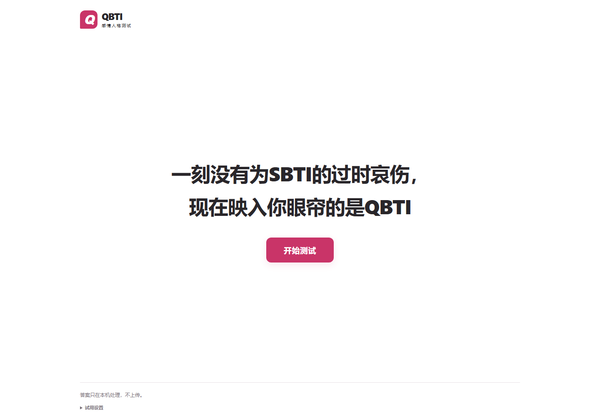

# QBTI · 感情人格测试

一个面向情感表达与分享的轻量Web应用：通过问答、26种原创角色和结果卡，将抽象偏好转化为可读、可分享的表达。

本仓库整理自本人提供的 `QBTI-xiaohongshu-v1.0.3.zip` 部署文件，展示可运行的浏览器端实现。首次公开提交发生于本次整理，不补造早期开发记录。



## 我负责的部分

独立完成产品构思、问答与类型内容、视觉和交互设计、AI辅助实现、部署及反馈迭代。使用AI协助代码和创作工作；需求取舍、内容核对与结果判断由本人完成。

## 建议先看

- `assets/data.js`：问答、类型内容和规则定义。
- `assets/engine.js`：匹配依据、必要条件、接近匹配与答案不足处理。
- `assets/app.js`：问答流程、结果卡、答案修改、维度展示及本机保存。
- `assets/style.css` 与角色素材：视觉表达和移动端体验。

## 运行

需要Node.js 18或更新版本，无第三方运行依赖，也不需要安装依赖：

```bash
npm start
```

打开 `http://127.0.0.1:8080`。也可用静态HTTP服务器托管仓库根目录；本次整理未新增线上部署或启用GitHub Pages。

## 产品判断与实现边界

- 结果由浏览器内预设规则匹配，运行时不调用大模型，不涉及模型训练。
- 该项目用于趣味表达，不作为心理诊断或经科学验证的人格量表。
- 修改答案、跳过问题与资料不足应有清楚反馈，结果不应把偏好误写成用户经历。
- 浏览器中的统计和草稿是本机数据，不是全站独立用户统计。

本人项目记录有累计2万余次使用及传播反馈；该数值不是独立用户数，也不是本仓库自带的统计服务。作品集中的合成答卷检查用于观察规则覆盖，不等同于真实用户效果或模型能力评测。

## 文件与权利

本次保留部署包中的应用与素材文件；仅新增项目说明、预览启动脚本和发布记录。未附用户答卷、缓存、账号配置或开发历史。仓库公开供求职审阅，不因公开自动授予额外的软件或素材使用许可。

更多说明见 [发布记录](docs/PUBLICATION.md)。
